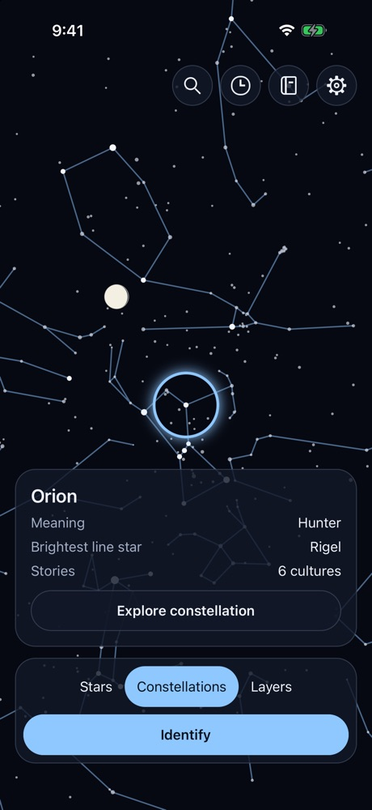
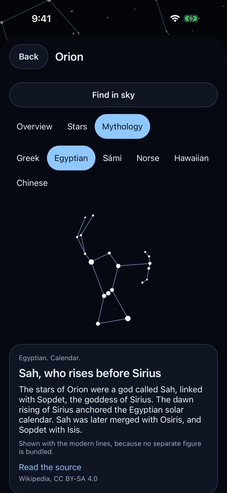
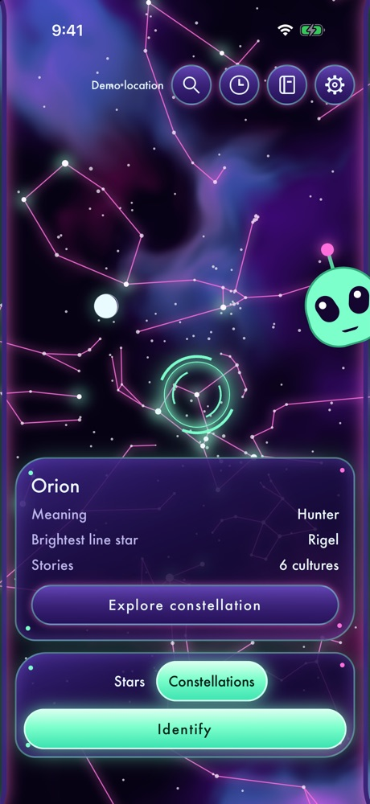
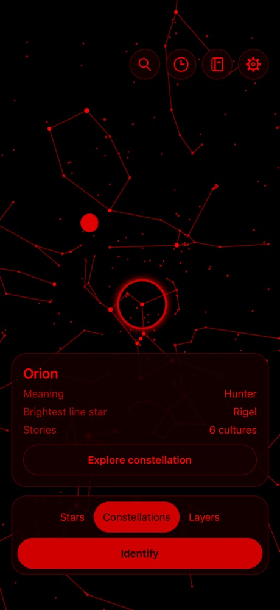
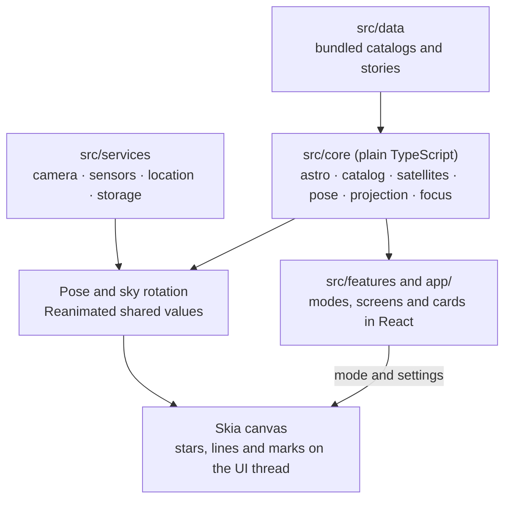

# Stellar

[](https://github.com/nwangemann/stellar/actions/workflows/check.yml)

Point a phone at the night sky and see what is there. Stellar draws the real stars, constellations, Moon, planets and bright satellites over the camera, locks on to whatever is under the reticle, and tells its story: catalog facts, known exoplanets, research papers, and the stories other cultures tell about it. Built with Expo, React Native and Skia.

<p>
  
  
  
  
</p>

## What it does

- **The real sky, now.** About 5,000 stars to magnitude 6 from the HYG catalog, the 88 constellations, the Sun, Moon (with its phase) and the naked-eye planets, placed for the current time and location.
- **Follow the phone or drag.** Device motion and true north move the sky with the phone; dragging works everywhere else. A compass alignment step corrects a wandering magnetometer against a known object.
- **Lock on and learn.** Hold the reticle on an object to lock on. Cards open details that zoom out of the object in the sky: facts, exoplanets and arXiv papers for stars; distance, phase, rise and set for bodies; a figure and stories from up to six traditions for constellations, such as Greek, Egyptian, Sámi, Hawaiian, Māori and Boorong, each with its source. Ten figures have stories so far.
- **Satellites.** The ISS and about 20 other bright satellites move across the Layers mode, from orbits fetched from CelesTrak with a bundled fallback. Each shows its height, speed, whether it is sunlit and its next visible pass.
- **Search, find and time travel.** Search any named star, constellation, body or satellite, then **Find in sky** turns the view to it, or points an arrow there while following the phone. A slider shows the sky from 12 hours back to 24 hours ahead.
- **Night vision and looks.** A pure red theme keeps dark-adapted eyes; a test checks that no night colour contains green or blue. Three optional looks (Starship, Glass & chrome with iOS Liquid Glass, and Needlepoint) restyle every control.
- **Logbook.** Identified objects are saved locally with time, pointing and place. Nothing is uploaded.

## Stack

Expo SDK 58 with development builds, React Native 0.88 (New Architecture), Expo Router, React Native Skia for the sky and backdrops, Reanimated and Gesture Handler for the frame loop and touch, VisionCamera, `expo-sensors`, `expo-location`, SQLite and MMKV for storage, Zustand for state, and `astronomy-engine` for solar system positions. TypeScript in strict mode, Jest, ESLint, Prettier, Husky and commitlint.

## Architecture



`src/core` imports no React or Expo, so the astronomy, projection and lock-on logic are plain functions with unit tests. The pose and the sky's rotation live in shared values: turning the phone redraws the canvas on the UI thread without a React render. Details in [docs/architecture.md](docs/architecture.md).

## What's interesting

- **Checked against JPL.** Positions of the Sun, Moon and planets are tested against JPL Horizons values for two sites ([ADR 15](docs/adr/0015-astronomy-engine.md)); stars use hand-written precession and sidereal time.
- **A cheap refresh.** The UI thread holds every star once as a J2000 vector; each minute only one rotation matrix and a few body directions cross over. A refresh dropped from about 190 ms to 16 ms of JavaScript on the simulator ([sky model](docs/systems/sky-model.md)).
- **Sensors without the jumps.** Orientation is smoothed as a quaternion, not as angles, so the sky does not swing when the phone points near the zenith; true north comes from the magnetic declination at the user's location ([ADR 16](docs/adr/0016-device-motion-true-north.md)).
- **Modes as plugins.** Stars, Constellations and Layers each implement one `LayerPlugin` interface that says what to draw, what can be locked on to and what the card shows.
- **Data with provenance.** Every catalog has its source, version and licence recorded ([data sources](docs/data-sources.md)); cultures under no-derivatives or non-commercial terms were left out, and every story links a fixed revision of its source.

## Run and test

Needs Node 22.13+, 24.3+ or 26+ and, for native builds, Xcode with an iOS simulator.

```bash
npm install
npm run ios        # development build on the iOS simulator
npm run web        # browser preview (no camera or sensors)
npm run check      # types, lint, formatting, 209 unit tests and doc checks
```

Android is configured but not yet built or tested.

## Status

The sky, satellites, details, search, find in sky, time travel, looks and logbook are built and checked in tests and on the iOS simulator. The camera, sensors, compass alignment, haptics and permission prompts need a physical iPhone and have not yet been tried on one, and satellite passes have not been checked against the real sky; those checks are the last task in the [backlog](docs/backlog/README.md). Photo capture is not built. Current state is in the [handoff](docs/handoff.md); the latest review is [docs/reviews/2026-11-25.md](docs/reviews/2026-11-25.md).

## Built with an AI agent

Stellar was written largely by an AI coding agent (Claude Code), steered by a person through written instructions, decision records and a backlog of session-sized steps. [docs/ai-workflow.md](docs/ai-workflow.md) explains how, and what the agent verified versus what is left to a person.

## Docs

- [Architecture](docs/architecture.md), [systems](docs/systems/) and [decisions](docs/adr/)
- [Backlog](docs/backlog/README.md) and [handoff](docs/handoff.md)
- [Data sources](docs/data-sources.md) and [dependencies](docs/dependencies.md)
- [Standards](docs/standards.md) and [changelog](CHANGELOG.md)

Agents start at [AGENTS.md](AGENTS.md).

## Licence

[MIT](LICENSE). Bundled data keeps its own licences; see [third-party notices](THIRD_PARTY_NOTICES.md).
