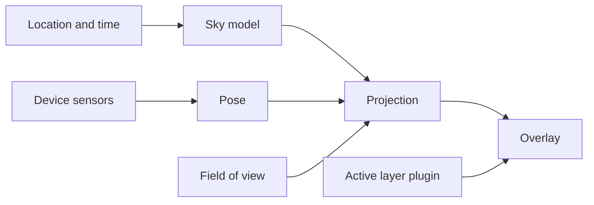

# Architecture

Stellar overlays the sky on the camera. It has three modes (Stars, Constellations and Layers, whose first layer is bright satellites), reticle lock-on and a logbook of identified objects.

- `src/core`: pure TypeScript. ESLint blocks React, Expo and app imports.
- `src/features`: one folder per feature. Modes implement `LayerPlugin`, whose `target` says whether a lock means a star or a constellation. A `SkyObject` is a star, a body (Sun, Moon, planet) or a satellite.
- `src/services`: adapters around native modules, with `.web` variants.
- `src/ui`: tokens and components. `src/state`: Zustand.
- `app`: thin Expo Router routes.

Pose lives in a Reanimated shared value so it never triggers React renders. The sky refreshes once a minute; satellites, which cross the sky in minutes, are placed ten times a second and eased between on the UI thread (`useMovingSky`).
The sky comes from bundled data in `src/data` (ADR 13). Satellite orbits are bundled too, as a fallback for orbits fetched from CelesTrak (ADR 18). Pose comes from `src/services/orientation` (ADR 16) through `useSensorPose`, or from dragging when sensors are off or unavailable.
